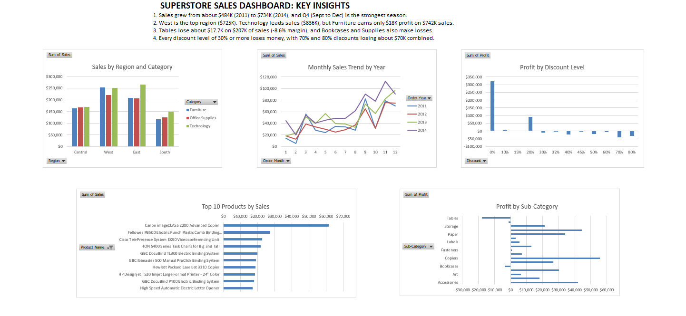
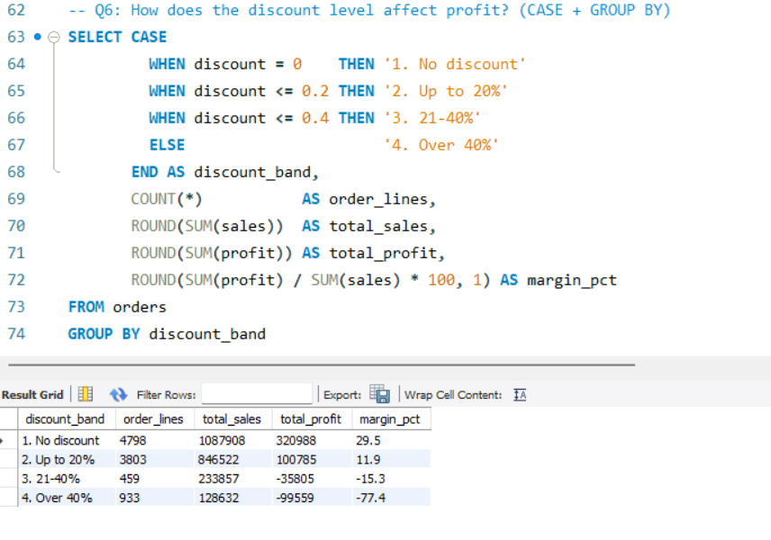
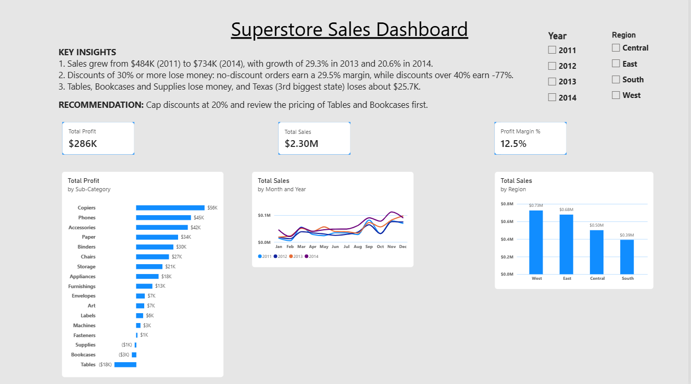
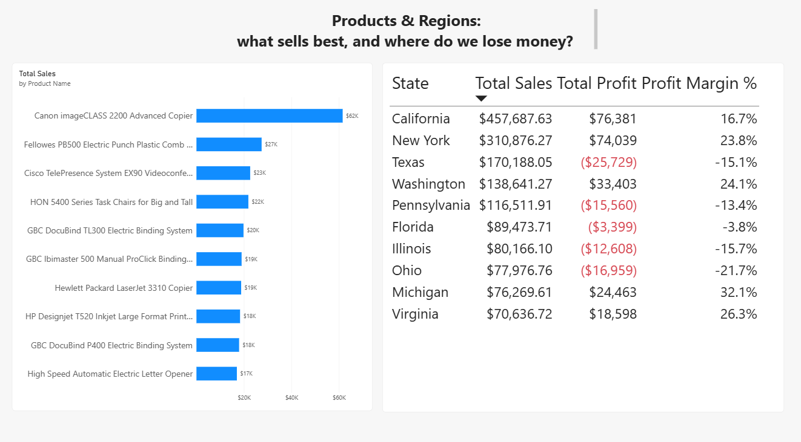
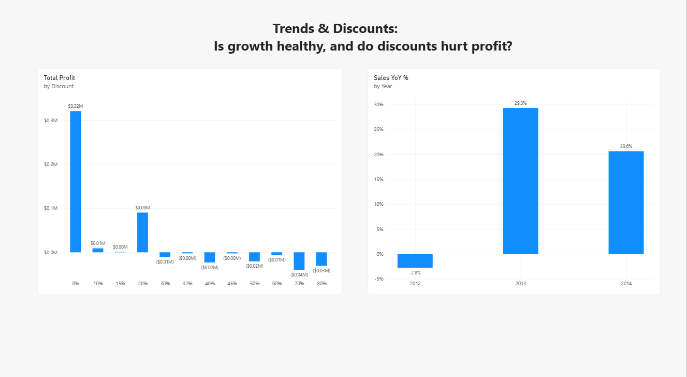

# Business Analytics Portfolio: Superstore Sales

One dataset, three tools: **Excel, SQL and Power BI**.
Dataset: Superstore Sales (9,994 order lines, 2011 to 2014, US retailer).

## Project 1: Excel Analysis

### Business problem
Which regions, products and discount levels drive profit, and where is the company losing money?

### What I did
- Converted the data into an Excel Table and removed 1 duplicate row (9,993 rows left)
- Checked for blanks (none) and added Order Year and Order Month columns
- Built pivot tables: sales by region and category, monthly trend, top 10 products, profit by sub-category, profit by discount level
- Built a 5-chart dashboard and an XLOOKUP lookup tool
- Used conditional formatting to highlight loss-making order lines

### Key findings
1. Sales grew from about $484K (2011) to $734K (2014), and Q4 is the strongest season.
2. West is the top region ($725K). Technology leads sales ($836K), but Furniture earns only $18K profit on $742K of sales.
3. Tables lose about $17.7K on $207K of sales (-8.6% margin). Bookcases and Supplies also make losses.
4. Every discount level of 30% or more loses money in total.

### Files
- `Excel/Superstore_Analysis.xlsx`: cleaned data, pivots, dashboard
- `Excel/excel_dashboard.png`: dashboard screenshot

## Project 2: SQL Analysis

### Business problem
Use SQL to answer the same business questions as the Excel project from a proper database: where does the company make money, which customers and products lose it, and what should management change?

### What I did
- Loaded the cleaned CSV (9,993 rows) into MySQL with a bulk load and checked the totals against the Excel pivot (sales $2,296,919, profit $286,409)
- Split the data into three tables: `customers` (793), `products` (1,862) and `orders` (9,993), linked by foreign keys
- Converted text dates into real dates and restored 5-digit ZIP codes
- Found a data quality issue: 32 product IDs had two name variants, so one name per ID is kept
- Wrote 10 queries, each with a comment stating the business question

### Queries (`SQL/queries.sql`)
| # | Business question | SQL concept |
|---|---|---|
| 1 | Sales and margin by region | GROUP BY |
| 2 | Monthly sales and profit trend | Date functions |
| 3 | Top 10 customers and their profit | JOIN |
| 4 | Top 10 loss-making products | JOIN + HAVING |
| 5 | Sub-categories below average margin | Subquery |
| 6 | Profit by discount band | CASE |
| 7 | Top 10 states by sales and profit | GROUP BY |
| 8 | Days to ship by shipping mode | DATEDIFF |
| 9 | Year-over-year sales growth | CTE + LAG |
| 10 | Value of each customer segment | JOIN + aggregates |

### Key findings
1. Revenue grew 29.3% in 2013 and 20.6% in 2014, after a small dip of 2.8% in 2012.
2. The #1 customer by sales (Sean Miller, about $25K) generated a loss of about $2K.
3. Discounts above 40% have a margin of -77.4%. No discount earns +29.5%.
4. Texas is the third-biggest state by sales ($170K) but loses about $25.7K.
5. Six sub-categories earn below the company average margin, and three of them (Tables, Bookcases, Supplies) lose money.

### Files
- `SQL/setup.sql`: how the database and tables were built
- `SQL/queries.sql`: the 10 business queries
- `SQL/superstore_clean.csv`: cleaned data used for the load

## Project 3: Power BI Dashboard

### Business problem
Give managers an interactive dashboard so they can explore sales, profit and discounts themselves, without asking an analyst.

### What I did
- Imported the cleaned Excel table and checked data quality in Power Query (100% valid)
- Built a star-schema model: one `Sales` table linked to `Customers`, `Products` and a `Calendar` table
- Wrote 4 DAX measures: Total Sales, Total Profit, Profit Margin % and Sales YoY %
- Built 3 report pages with Year and Region slicers, and red highlighting for loss-making states
- Added an insights box with 3 findings and a recommendation

### Pages
| Page | Question it answers |
|---|---|
| Overview | How big is the business, and where is the money made or lost? |
| Products & Regions | What sells best, and which big states lose money? |
| Trends & Discounts | Is growth healthy, and do discounts hurt profit? |

### Key findings
1. Total sales are $2.30M with $286K profit (12.5% margin), and all totals match the Excel and SQL results.
2. West is the top region ($725K), and the Canon imageCLASS 2200 copier is the top product ($61.6K).
3. Tables, Bookcases and Supplies lose money, and Texas (3rd biggest state) loses about $25.7K.
4. Discounts of 30% or more lose money overall. Sales grew 29.3% in 2013 and 20.6% in 2014.

### Recommendation
Cap discounts at 20% and review the pricing of Tables and Bookcases first.

### Files
- `PowerBI/Superstore_Dashboard.pbix`: the dashboard (open with Power BI Desktop)
- `PowerBI/powerbi_*.png`: page screenshots

## One dataset, three tools
Excel found the problems, SQL confirmed them with a proper database, and Power BI turned them into an interactive dashboard. All three give the same totals ($2,296,919 sales, $286,409 profit).
